# RoadHazard — AI-Powered Road Hazard Detection & Reporting


A full-stack system that lets the public report road damage from a phone photo, uses a custom-trained
**YOLOv8** model to detect and classify the hazard, and gives road authorities a dashboard to review,
assign and track repairs. It was built for Malaysian road conditions as my Final Year Project
(CAT405, School of Computer Sciences, Universiti Sains Malaysia).

🥈 **Silver Award, PIXEL 2026** (USM School of Computer Sciences project showcase) · entered in the **IEM IDEAS Competition 2026**
<br/>▶️ [**Watch the demo video**](https://youtu.be/7WFv5joPx0U) · 🌐 [Portfolio](https://hazzywan.github.io/#work)

> **Note:** This repository is a portfolio showcase of the source code. Training datasets (~13 GB),
> credentials and environment files are intentionally excluded, so the project is not meant to be
> cloned and run as-is.

<p align="center">
  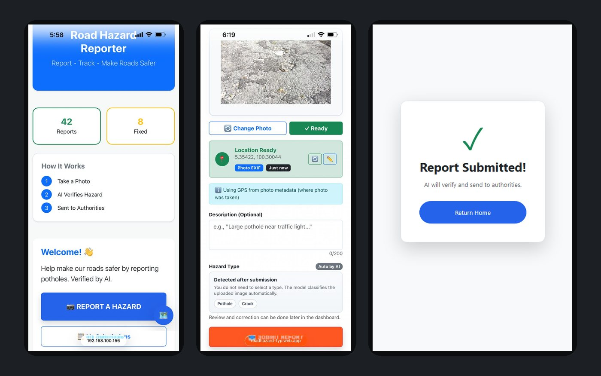
  <br/><em>Public reporting on mobile: take a photo, location is read from EXIF, and the AI classifies the hazard after submission.</em>
</p>

<p align="center">
  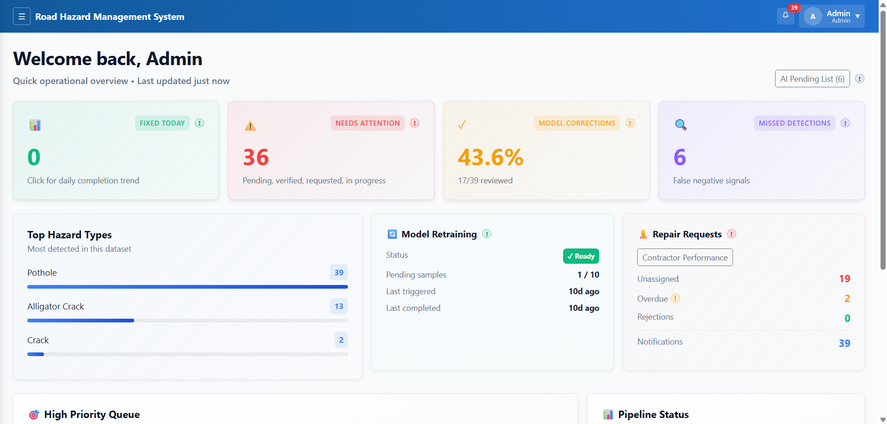
  <br/><em>Authority dashboard: open workload, model-correction rate, missed detections, retraining status and repair pipeline.</em>
</p>

---

## Highlights

- **Custom object detection model:** YOLOv8 detector for potholes and crack types, trained on a merged
  Malaysian road dataset (now 8,560 labelled images), reaching **79.8% mAP@0.5** on validation.
- **Robust inference pipeline:** two-pass inference with CLAHE enhancement, texture-based pothole/crack
  re-checking, crack bounding-box relocalisation and shadow guarding on top of raw YOLO output.
- **Tropical-condition stress testing:** six synthetic scenarios (sun glare, canopy shadow, monsoon rain,
  wet surface, fog/haze, low light) with weighted consensus scoring to judge prediction stability.
- **Human-in-the-loop MLOps:** admin corrections are written back as YOLO-format training samples, and an
  optional auto-retrain runs once enough feedback accumulates. The new model goes live only if its validation
  mAP@0.5 beats the current one.
- **End-to-end product:** anonymous public reporting with EXIF GPS extraction, an interactive Leaflet map,
  an admin dashboard, a contractor portal, and email notifications for repair assignments and status updates.
- **Cloud deployment:** containerised Flask API on Google Cloud Run and a React SPA on Firebase Hosting, plus
  cost-control scripts (maintenance mode, Artifact Registry and Storage lifecycle policies).

---

## System Architecture

<p align="center">
  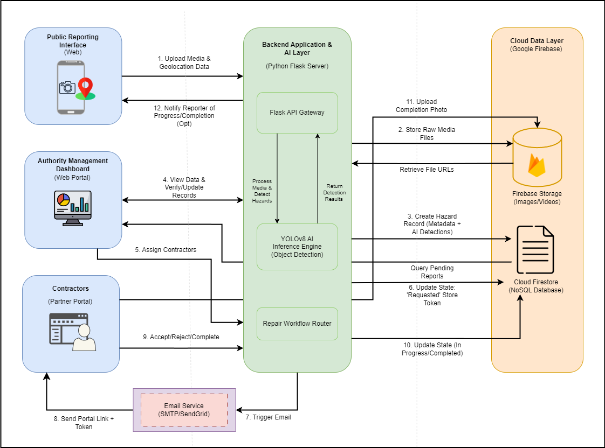
</p>

<details>
<summary><b>Deployment view</b> (cloud services)</summary>

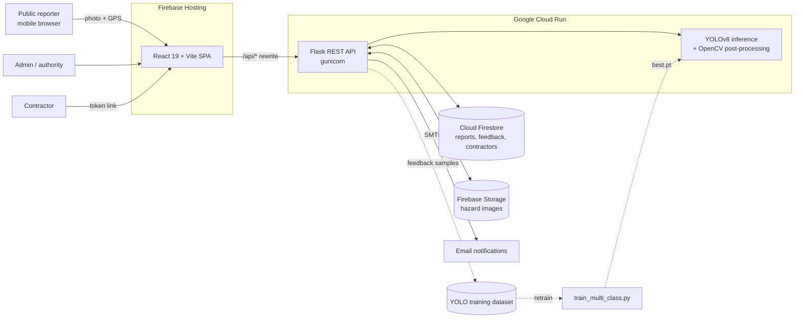

</details>

---

## Tech Stack

| Layer | Technologies |
|---|---|
| **Machine learning** | Ultralytics YOLOv8, PyTorch, OpenCV, NumPy, Roboflow (dataset sourcing and annotation) |
| **Backend** | Python, Flask, Flask-CORS, Gunicorn, Firebase Admin SDK, Pillow (EXIF/GPS), SMTP |
| **Frontend** | React 19, Vite, React Router, Bootstrap 5, Leaflet (maps), Axios, exifr, Firebase JS SDK (real-time updates) |
| **Data and storage** | Cloud Firestore (NoSQL), Firebase Storage |
| **Infrastructure** | Docker, Google Cloud Run, Cloud Build, Artifact Registry, Firebase Hosting |
| **Tooling** | Jupyter (report figures), PowerShell and Bash automation scripts, ESLint |

---

## Machine Learning Model

| | |
|---|---|
| **Architecture** | YOLOv8n (transfer learning from COCO-pretrained weights) |
| **Classes** | `pothole`, `alligator_crack`, `longitudinal_crack`, `transverse_crack`, `other` (low-confidence crack subtypes are shown as a generic `crack`) |
| **Dataset** | **8,560 labelled Malaysian road images** today (7,268 train / 862 validation / 430 test), plus augmented copies; it has grown since the bundled model was trained |
| **Sources** | Malaysian pothole dataset, Roboflow "crack and pothole" dataset, Malaysian road crack dataset, plus user-submitted reports |
| **Training** | 100 epochs, 640 × 640 input, batch size 8 |

**Validation results** for the bundled weights ([`runs/detect/road_hazards_multi6`](runs/detect/road_hazards_multi6), best epoch):

| Precision | Recall | mAP@0.5 | mAP@0.5:0.95 |
|:-:|:-:|:-:|:-:|
| 0.805 | 0.744 | **0.798** | 0.457 |

<p align="center">
  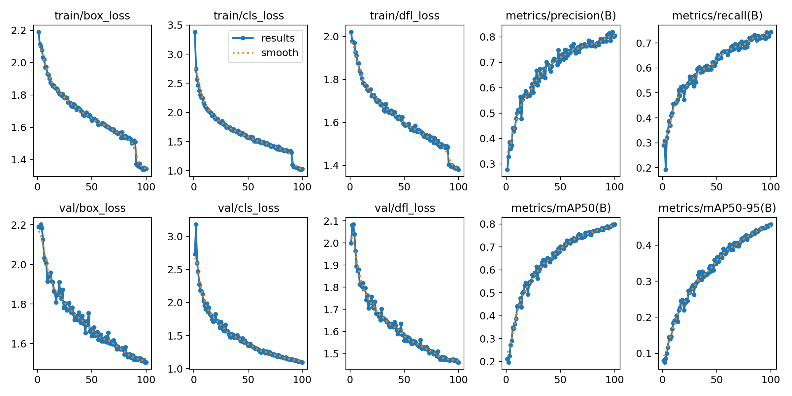
</p>

<details>
<summary><b>Confusion matrix</b></summary>
<p align="center">
  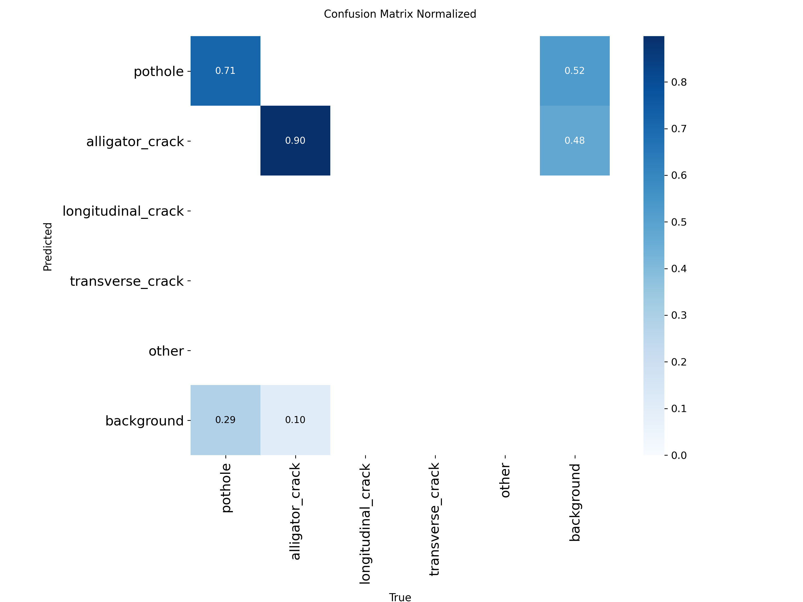
</p>
</details>

**Real-world behaviour**, including a known failure case:

<p align="center">
  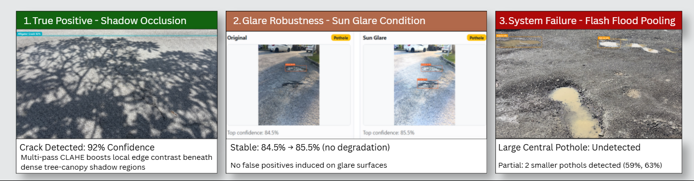
</p>

**Tropical-condition stress test.** The same image is run through six simulated scenarios to check
whether the prediction stays stable:

<p align="center">
  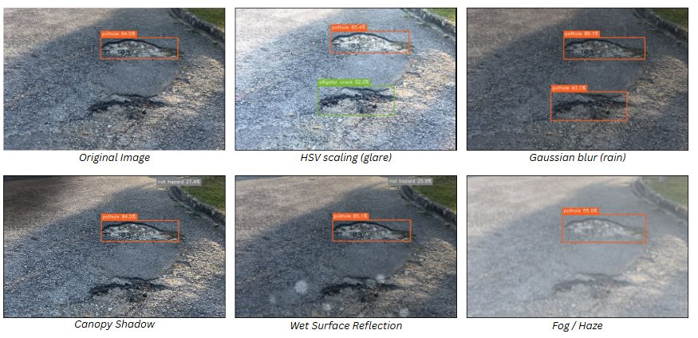
</p>

### Inference pipeline

1. **Ingestion:** the image is uploaded, GPS is read from EXIF (falling back to device location), and the image is fingerprinted so earlier admin corrections for the same image can guide the result.
2. **First pass:** YOLOv8 inference with per-class confidence thresholds.
3. **Second pass:** if nothing is found, the image is enhanced (CLAHE + sharpening) and inference re-runs at a lower threshold.
4. **Post-processing:**
   - Texture analysis re-checks elongated "pothole" boxes that are likely cracks.
   - Crack regions are re-cropped and re-inferred for tighter boxes.
   - Shadow-dominant alligator cracks are downgraded.
   - Low-confidence crack subtypes collapse to a generic `crack`.
5. **Scenario consensus:** inference across six simulated tropical conditions; weighted class scores decide a stable final label.
6. **Feedback loop:** admin corrections become new YOLO-labelled samples; retrained models are promoted only if validation mAP@0.5 improves.

Algorithm details: [`docs/guides/ALGORITHM_REFERENCE.md`](docs/guides/ALGORITHM_REFERENCE.md)

---

## Application Features

| Role | Capabilities |
|---|---|
| **Public reporter** (anonymous) | Submit a photo with automatic location, view AI result instantly, track own submissions via an HMAC-signed reporter token, opt in to email status updates |
| **Admin / authority** | Dashboard with stats and map, review/approve/reject reports, correct AI labels and draw bounding boxes, run augmentation confidence analysis, manage contractor directory, monitor dataset and retraining state |
| **Contractor** | Token-based partner portal to view assigned repairs and update repair status |

### Screenshots

| | |
|:-:|:-:|
| 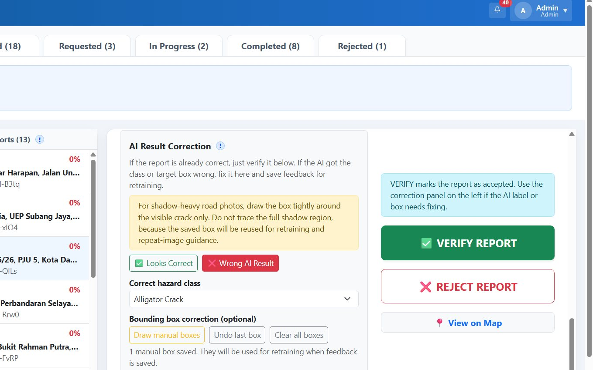 | 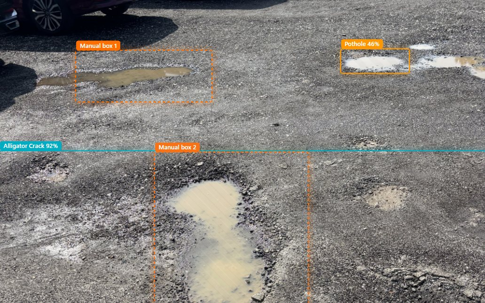 |
| **AI result correction:** admins verify or relabel detections; corrections feed retraining | **Manual bounding boxes:** missed hazards are boxed by hand and saved as YOLO training labels |
| 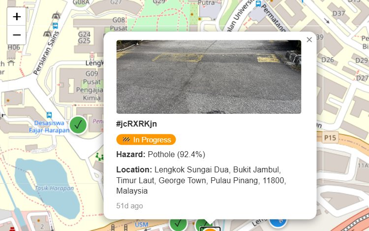 | 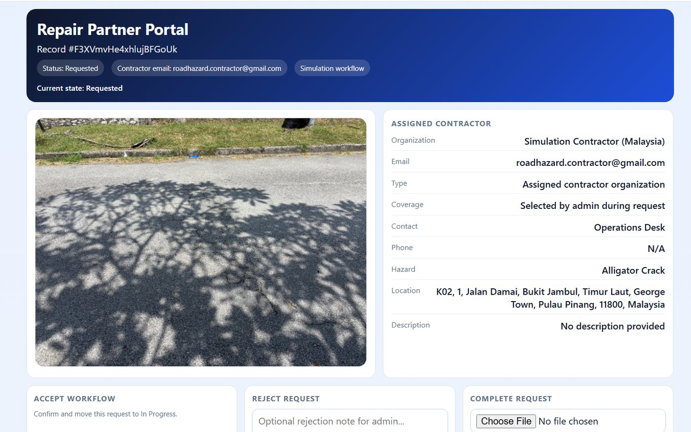 |
| **Live hazard map:** Leaflet map with status-coded markers and report details | **Repair partner portal:** contractors accept, reject or complete jobs with photo evidence |

---

## Project Structure

```
├── webapp/                  Flask REST API: inference pipeline, auth, reports, feedback, email
├── frontend/                React + Vite single-page app
│   └── src/components/      Report form, map, admin dashboard pages, partner portal
├── train_multi_class.py     YOLOv8 training entry point (also used by auto-retrain)
├── runs/detect/…/           Model weights (best.pt) and training artifacts
├── scripts/
│   ├── ml/                  Dataset merging, balancing, auto-labelling, label review, realtime detection
│   ├── firebase/            Firestore/Storage auditing and cleanup tools
│   ├── cloud/               Cloud Run / Artifact Registry / GCS cost-control scripts
│   └── report/              Evaluation helpers (confusion-matrix aggregation, figures)
├── notebooks/               Figure generation for the thesis
├── docs/                    Guides, development logs, test cases, screenshots
├── Dockerfile               Cloud Run container image
├── firebase.json            Hosting config with /api rewrites to Cloud Run
├── deploy.sh / update_hosting.ps1   Deployment automation
└── start_all.ps1 / stop_all.ps1     Local development launcher (localhost or LAN/HTTPS)
```

---

## Documentation

- [Algorithm reference](docs/guides/ALGORITHM_REFERENCE.md)
- [Hosting guide](docs/guides/HOSTING_GUIDE.md) · [Operations commands](docs/guides/OPERATIONS_COMMANDS.md)
- [Training guide](docs/guides/TRAINING_GUIDE.md) · [Development log](docs/logs/DEVELOPMENT_LOG.md)
- [Test cases](docs/testing/TEST_CASES.md)

---

## Author

**Ahmad Hazwan Syauqee**, School of Computer Sciences, Universiti Sains Malaysia
